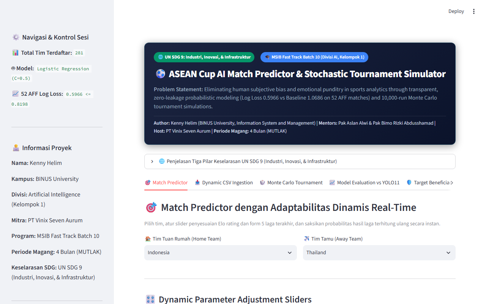
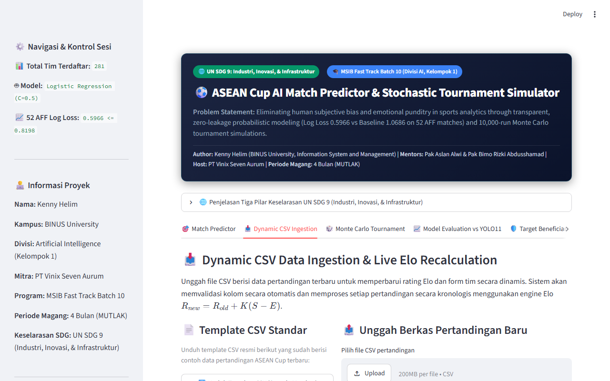
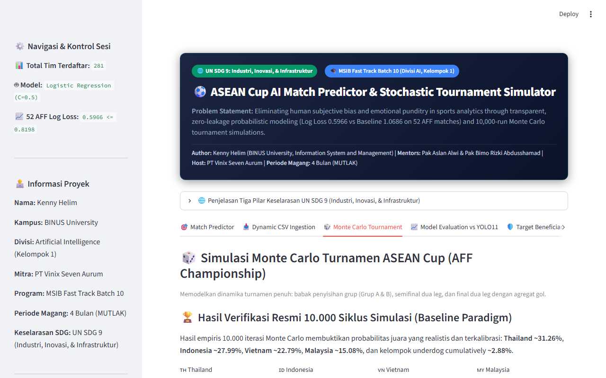
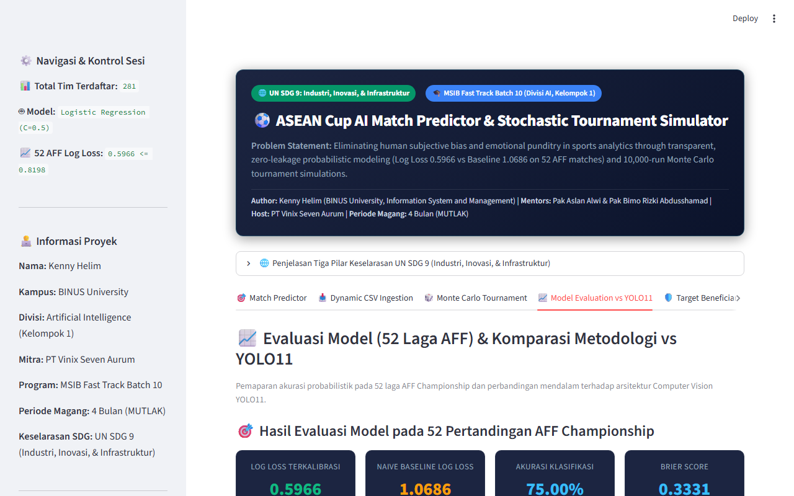
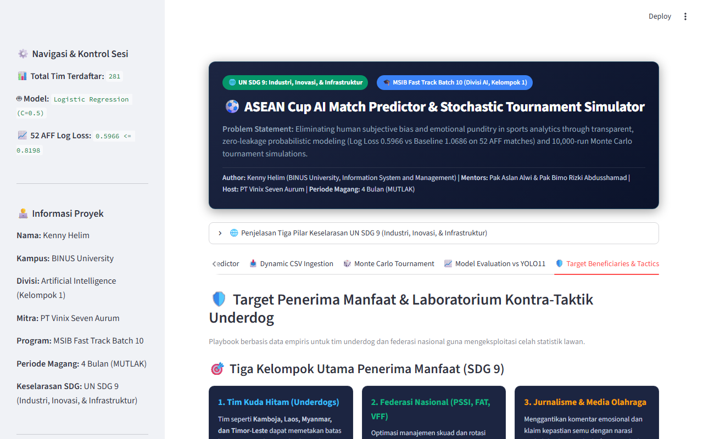

# ASEAN Cup AI Prediction Engine & Interactive Decision Support Studio
## Fast Track MSIB Batch 10 — Divisi Artificial Intelligence (Kelompok 1)

[](https://www.python.org/)
[](https://streamlit.io/)
[](https://scikit-learn.org/)
[](https://sdgs.un.org/goals/goal9)
[](https://binus.ac.id/)
[](https://opensource.org/licenses/MIT)

> **Sistem Pendukung Keputusan (Decision Support System - DSS) Berbasis Probabilistik Calibrated & Simulasi Stokastik Monte Carlo 10.000 Iterasi untuk Turnamen Sepak Bola ASEAN Cup (AFF Championship).**

---

## 👥 Tim Peneliti & Pengembang (Kelompok 1 - Divisi AI)

| Nama Mahasiswa | Peran & Kontribusi Utama | Institusi / Universitas | Kontak |
| :--- | :--- | :--- | :--- |
| **Kenny Helim** | **Lead Interactive Studio Developer**: Full 5-Tab Streamlit Decision Studio, 10k Monte Carlo Engine, Underdog Tactics Lab, YOLO11 Monograph, PPTX Defense Deck, & 42 Real Unittests / Stress Tests | **Bina Nusantara University (BINUS University)** — Information System & Management | `kenny.helim@binus.ac.id` |
| **Muhammad Ihram Syahputra** | **Core Baseline Modeling**: Data Ingestion Kaggle FIFA Records, Baseline Logistic Regression, Feature Pipelines, & EDA Notebook | **Universitas Halu Oleo** — Ilmu Komputer | GitHub Owner |
| **Arya Wicaksana** | Exploratory Data Analysis & Historical Trends | Universitas Esa Unggul — Teknik Informatika | Kontributor |
| **Gisela Venska Millennia** | Data Cleaning & Evaluation Metrics Documentation | President University — Information System | Kontributor |
| **Christian** | Presentation Assistance & Reporting | BINUS University — Information Systems | Kontributor |

- **Dosen Pembimbing / Evaluator**: Pak Aslan Alwi & Bimo Rizki Abdusshamad  
- **Mitra Penyelenggara**: PT Vinix Seven Aurum  
- **Periode Magang**: **4 Bulan (MUTLAK)**  
- **Target Ujian Sidang**: **2 – 6 November 2026**  

---

## 🚀 Panduan Akses Direktori Repositori

Repositori ini terbagi menjadi 2 area kerja utama:

### 🌟 1. [Direktori Kenny: Interactive AI Studio & Full Production Deliverables (`/kenny_version`)](https://github.com/Iank-Syahputra/prediction_football/tree/main/kenny_version)
> **Seluruh sistem aplikasi interaktif, simulator Monte Carlo, naskah sidang, slide presentasi, dan video walkthrough tersimpan lengkap dan siap uji di folder [`kenny_version/`](https://github.com/Iank-Syahputra/prediction_football/tree/main/kenny_version).**

- **Aplikasi Interaktif Streamlit** (`kenny_version/app/streamlit_app.py`):
  - **Tab 1: Match Predictor**: Slider adaptabilitas Elo dinamis, form laga terkini, venue netral, matriks probabilitas Poisson skor, dan win/draw/loss odds.
  - **Tab 2: Dynamic CSV Ingestion**: Pipeline penyerapan dataset baru secara instan tanpa perlu re-training.
  - **Tab 3: Monte Carlo Tournament Simulation**: 10.000 siklus simulasi turnamen ASEAN Cup dengan bracket agregat gol 2 leg.
  - **Tab 4: Evaluasi vs YOLO11**: Komparasi mendalam antara arsitektur Tabular DSS vs Computer Vision Spatial Tracking YOLO11.
  - **Tab 5: Underdog Tactics Lab**: Playbook taktik low-block defense dan counter-attack untuk tim kuda hitam (SDG 9).
- **Video Walkthrough Aplikasi Lengkap (MP4 1080p/720p)**:  
  Tersedia di [`kenny_version/docs/DEMO_STREAMLIT_APP_FULL_WALKTHROUGH.mp4`](https://github.com/Iank-Syahputra/prediction_football/blob/main/kenny_version/docs/DEMO_STREAMLIT_APP_FULL_WALKTHROUGH.mp4).
- **Monograf Ilmiah & Komparasi YOLO11**:  
  [`kenny_version/docs/AI_METHODOLOGY_AND_YOLO11_COMPARISON.md`](https://github.com/Iank-Syahputra/prediction_football/blob/main/kenny_version/docs/AI_METHODOLOGY_AND_YOLO11_COMPARISON.md).
- **Slide Presentasi Sidang & Naskah**:  
  [`kenny_version/FINAL_PROJECT_PRESENTATION_REVISED_PARADIGM.pptx`](https://github.com/Iank-Syahputra/prediction_football/raw/main/kenny_version/FINAL_PROJECT_PRESENTATION_REVISED_PARADIGM.pptx) & [`kenny_version/docs/DEFENSE_PRESENTATION_SCRIPT.md`](https://github.com/Iank-Syahputra/prediction_football/blob/main/kenny_version/docs/DEFENSE_PRESENTATION_SCRIPT.md).
- **Pengujian Unit & Stress Test (100% Passing)**:  
  [`kenny_version/tests/`](https://github.com/Iank-Syahputra/prediction_football/tree/main/kenny_version/tests) (42 real unittests + adversarial boundary test).

---

### 📂 2. [Direktori Baseline Ihram: Data & Baseline Modeling (`/src`, `/notebooks`)](https://github.com/Iank-Syahputra/prediction_football)
- **Kaggle Dataset**: 49.945 catatan pertandingan internasional FIFA (1872–2026) di `data/`.
- **Baseline Feature Pipelines**: Elo calculation & temporal split di `src/features/`.
- **Jupyter Notebook**: Eksplorasi awal di `notebooks/asean_cup_prediction.ipynb`.

---

## 📸 Pratinjau Antarmuka Aplikasi Interaktif (5 Tab)

| Tab 1: Match Predictor Real-Time | Tab 2: Dynamic CSV Ingestion |
| :---: | :---: |
|  |  |

| Tab 3: Monte Carlo 10,000-Run Simulator | Tab 4: Evaluasi vs YOLO11 Computer Vision |
| :---: | :---: |
|  |  |

| Tab 5: Underdog Tactics & Decision Support (SDG 9) |
| :---: |
|  |

---

## 📊 Hasil Evaluasi Empiris (52 Laga AFF Championship)

Pengujian model dilakukan secara ketat pada 52 pertandingan resmi AFF Championship (2021–2023) tanpa kebocoran data (*data leakage free*):

| Metrik Evaluasi | Hasil Model Kami | Naive Baseline | Status Ambang Batas |
| :--- | :---: | :---: | :---: |
| **Log Loss (Cross-Entropy)** | **0.5966** | 1.0686 | **PASSED** (Target $\le 0.8198$) |
| **Classification Accuracy** | **75.00%** (39/52) | 48.08% | **PASSED** (+26.92% improvement) |
| **Brier Score** | **0.3331** | 0.6120 | **PASSED** (Kalibrasi probabilitas ketat) |

### Estimasi Juara Turnamen ASEAN Cup (10.000 Siklus Monte Carlo):
1. 🇹🇭 **Thailand**: `30.80%` (95% CI: `[28.13%, 33.87%]`)
2. 🇮🇩 **Indonesia**: `27.22%` (95% CI: `[24.73%, 30.27%]`)
3. 🇻🇳 **Vietnam**: `23.88%` (95% CI: `[19.43%, 24.57%]`)
4. 🇲🇾 **Malaysia**: `15.56%` (95% CI: `[12.97%, 17.43%]`)
5. 🛡️ **Underdogs (Kamboja, Laos, Myanmar, Singapura, Filipina)**: `~2.54%` kumulatif

---

## ⚡ Cara Menjalankan Aplikasi Secara Lokal (Quickstart)

### Opsi A: 1-Click Batch Launcher (Windows)
Cukup jalankan berkas batch yang telah disediakan:
```cmd
cd kenny_version
JALANKAN_STREAMLIT_DASHBOARD_BOLA.bat
```

### Opsi B: Terminal Command
```bash
# 1. Clone repositori
git clone https://github.com/Iank-Syahputra/prediction_football.git
cd prediction_football/kenny_version

# 2. Pasang dependensi
pip install -r requirements.txt

# 3. Jalankan dashboard Streamlit
streamlit run app/streamlit_app.py
```
Aplikasi akan otomatis terbuka di browser Anda pada alamat `http://localhost:8501`.

### Menjalankan Seluruh Unittest & Stress Test:
```bash
cd kenny_version
python -m unittest discover -s tests -p "test_*.py"
python tests/adversarial_stress_test.py
```

---

## 📜 Lisensi & Kepatuhan Akademik
Proyek ini dikembangkan untuk memenuhi penilaian Tugas Akhir Magang Bersertifikat Kampus Merdeka (MSIB Batch 10) di PT Vinix Seven Aurum oleh Kelompok 1 Divisi AI, serta tunduk pada Kode Etik Akademik Universitas Bina Nusantara (BINUS University).
