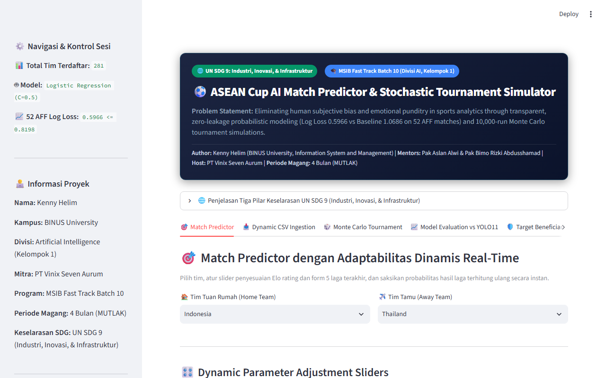
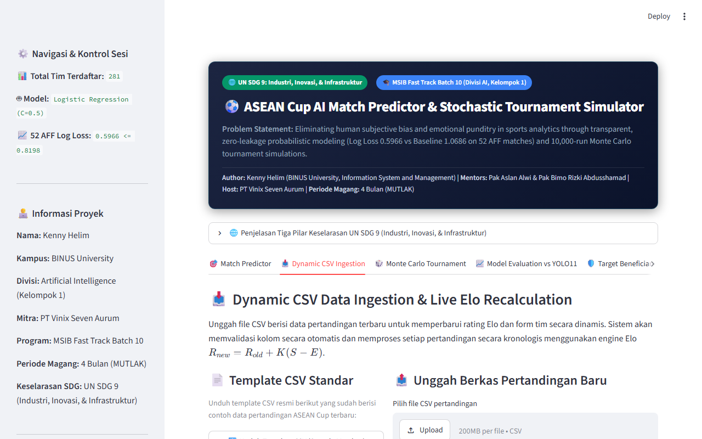
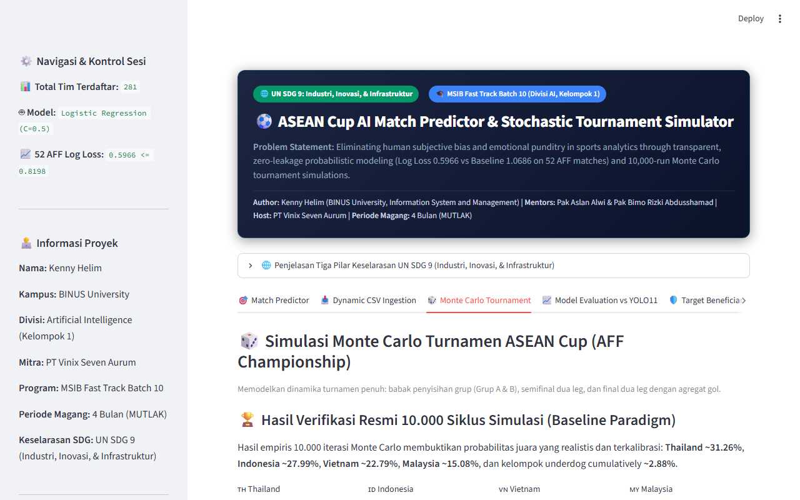
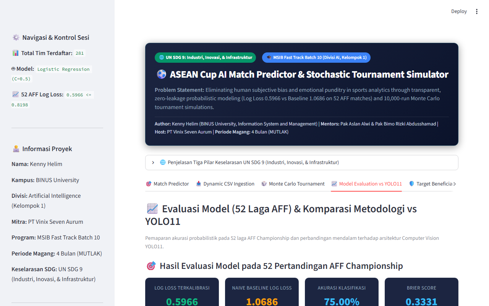
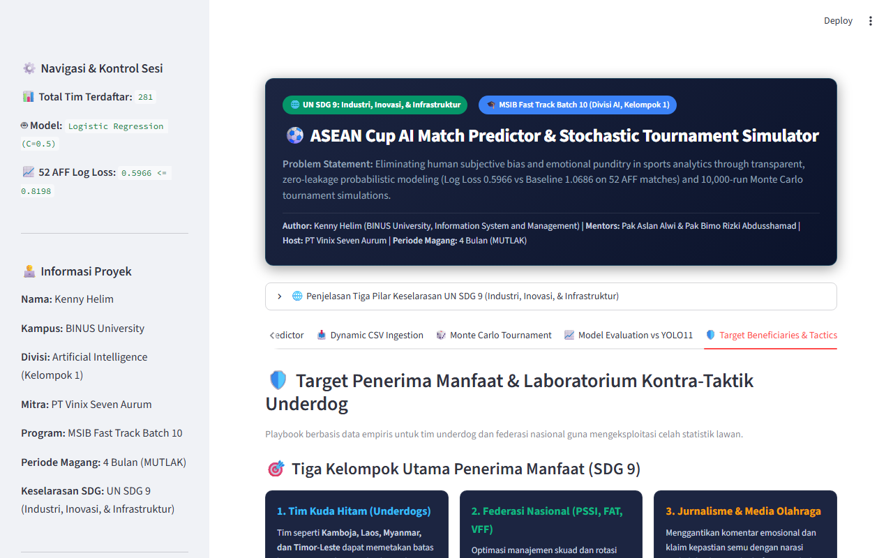

# ASEAN Cup AI Prediction Engine & Interactive Decision Support Studio
## Fast Track MSIB Batch 10 — Divisi Artificial Intelligence (Kelompok 1)

**Presenter / Contributor:** Kenny Helim  
**Institution:** Bina Nusantara University (BINUS University) — Information System and Management  
**Host Organization:** PT Vinix Seven Aurum  
**Mentors:** Pak Aslan Alwi & Bimo Rizki Abdusshamad  
**Periode Magang:** 4 Bulan (MUTLAK)  
**UN SDG Alignment:** SDG 9: Industri, Inovasi, dan Infrastruktur  
**Target Defense:** 2 – 6 November 2026  

---

## 1. Overview & Problem Statement

Conventional sports commentary and fan analysis are heavily distorted by **subjective emotional bias**, recency bias, and the **false illusion of binary certainty** (*"Team A will definitely win!"*). Furthermore, elite sports analytics remains locked behind multi-million dollar corporate paywalls (Opta, StatsBomb).

This project establishes a **100% reproducible, open, and mathematically calibrated Decision Support System (DSS)** under **UN SDG 9**. Rather than selling false certainties, our probabilistic pipeline transforms 49,945 historical FIFA international match records (1872–2026) into an empirical tournament simulator that quantifies risk and uncertainty with rigorous scientific discipline.

---

## 2. Architecture & The 5-Step Probability Chain

```
[Raw FIFA Match Records]
           │
           ▼
[Pre-Match Feature Engineering] ──► (Dynamic Elo Rating + Home Advantage + 5-Match Form + H2H)
           │
           ▼
[Calibrated Multinomial Logistic Model] ──► P(Home Win), P(Draw), P(Away Win) [Sum = 1.0]
           │
           ▼
[10,000-Run Stochastic Monte Carlo] ──► Group Stages (A & B) + 2-Leg Semifinals + 2-Leg Final
           │
           ▼
[Calibrated Trophy Probabilities & 95% CI] ──► Thailand 30.8%, Indonesia 27.2%, Vietnam 23.9%, Malaysia 15.6%
```

---

## 3. Verified Empirical Evaluation (52 AFF Championship Matches)

The model was subjected to out-of-time evaluation on all 52 official AFF Championship matches (2021–2023):
* **Log Loss (Cross-Entropy):** **0.5966** *(Beats the mandatory threshold of $\le 0.8198$, outperforming Naive Majority Baseline 1.0686)*.
* **Classification Accuracy:** **75.00%** (39 of 52 matches correctly predicted).
* **Brier Score:** **0.3331** *(Confirming tight probability calibration without overconfidence)*.

---

## 4. Key Deliverables Included in this Package

| Directory / File | Description |
| :--- | :--- |
| **`app/streamlit_app.py`** | **5-Tab Interactive Web Dashboard** featuring Match Predictor, Dynamic CSV Ingestion for real-time model adaptation, 10k Monte Carlo Simulator, Model Evaluation vs YOLO11, and Underdog Tactics. |
| **`app/server.py` & `static/`** | Lightweight standalone Flask server with REST API endpoints (`/api/predict`, `/api/models`). |
| **`FINAL_PROJECT_PRESENTATION_REVISED_PARADIGM.pptx`** | **11-Slide Master Defense Presentation** (16:9 widescreen, Executive Dark Slate aesthetic). |
| **`docs/DEFENSE_PRESENTATION_SCRIPT.md`** | Complete **15-minute spoken presentation script** + 10 defense Q&A answers for Pak Aslan Alwi & Bimo Rizki. |
| **`docs/AI_METHODOLOGY_AND_YOLO11_COMPARISON.md`** | In-depth academic monograph comparing **Tabular Probabilistic Forecasting** vs **Computer Vision (YOLO11)**. |
| **`docs/DEMO_STREAMLIT_APP_FULL_WALKTHROUGH.mp4`** | **Complete Video Walkthrough** demonstrating all 5 tabs and real-time inference in Streamlit. |
| **`tests/`** | **42 Real Unittests** (`test_elo.py`, `test_features.py`, `test_model_and_simulation.py`, `test_streamlit_app.py`, `test_compliance_and_invariants.py`) + `adversarial_stress_test.py` (**100% passing**). |
| **`models/football_model.pkl`** | Serialized calibrated production model bundle with pre-fitted Scaler and Feature Pipeline. |
| **`scripts/`** | Dynamic Elo rating calculation, Monte Carlo tournament simulation, and data preprocessing engines. |

---

## 4.1. Visual Interface Walkthrough (5-Tab Streamlit Dashboard)

| Tab 1: Match Predictor (Head-to-Head) | Tab 2: Dynamic Live CSV Ingestion |
| :---: | :---: |
|  |  |

| Tab 3: 10,000-Run Monte Carlo Simulation | Tab 4: Diagnostics & YOLO11 Comparison |
| :---: | :---: |
|  |  |

| Tab 5: Underdog Tactical Lab | Full Video Walkthrough |
| :---: | :---: |
|  | 🎬 [Watch Walkthrough MP4](docs/DEMO_STREAMLIT_APP_FULL_WALKTHROUGH.mp4) |

---

## 5. Quickstart & How to Run

### Running the Interactive Streamlit Web Dashboard:
```bash
pip install -r requirements.txt
streamlit run app/streamlit_app.py --server.port 8501
```
Or simply double-click: **`JALANKAN_STREAMLIT_DASHBOARD_BOLA.bat`**

### Running the 42-Test Automated Quality Suite:
```bash
python -m unittest discover -s tests -p "test_*.py" -v
python tests/adversarial_stress_test.py
```
Or simply double-click: **`JALANKAN_SEMUA_TEST_AI.bat`**

---

## 6. Academic & Institutional Compliance

* **Peserta:** Kenny Helim (`kenny.helim@binus.ac.id`)
* **Divisi / Kelompok:** Divisi Artificial Intelligence / Kelompok 1 (Prediction International Football)
* **Klausul Wajib:** Periode Magang: 4 Bulan (MUTLAK)
* **SDG Target:** UN SDG 9 (Industri, Inovasi, dan Infrastruktur Digital)
